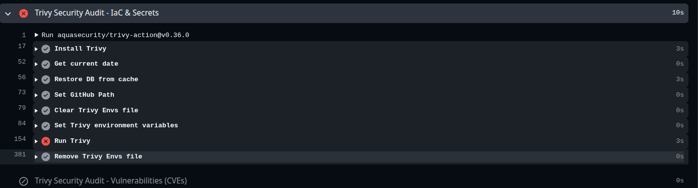
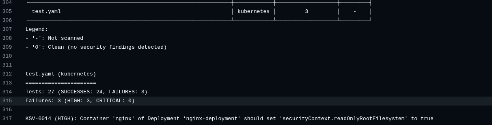
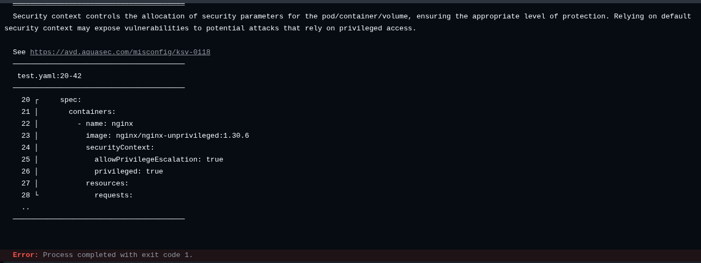
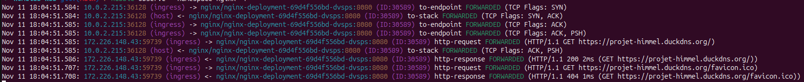
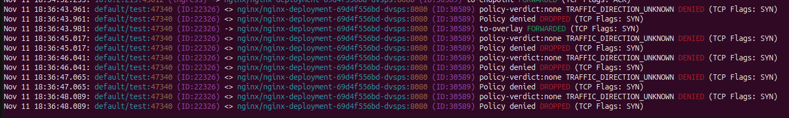
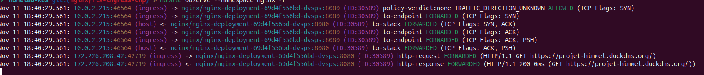

# Devlog 21 : Trivy et CiliumNetworkPolicy sur Nginx

## 1. Avant-propos

De nombreuses failles de sécurité m'ont été remontées après un audit de sécurité du cluster réalisé avec une IA. Le but de cet audit était de voir les points faibles du cluster, et surtout ceux dont moi, débutant, n'avais même pas conscience. Suite à cet audit, un tableau des vulnérabilités a été établi.

Dans ce devlog, je reviendrai sur deux points précis de cet audit, que j'ai pu corriger. Nous verrons dans un premier temps tout ce qui concerne Trivy : le scan `vuln` déjà en place, l'introduction d'un scan d'image, etc. Ensuite, je parlerai de la nouvelle CNP¹ mise en place sur le namespace Nginx. Enfin, hors audit, je discuterai d'une nouvelle piste concernant le chemin d'un paquet, qui fera office de suite, et en partie de conclusion, au devlog 20, qui se terminait sans réponse concrète.

_¹CNP : CiliumNetworkPolicy_

## 2. Trivy

### A. Observations

Après l'audit, j'ai décidé d'observer le comportement de mes outils, de chercher à vraiment comprendre comment ils fonctionnaient et comment ils étaient réellement implémentés. C'est dans cette démarche que j'ai découvert que Trivy ne mettait pas la CI en échec malgré des failles détectées (#26). J'ai aussi mené différents tests sur les scanners en place, et il s'est avéré que le scanner `vuln` ne scannait en réalité rien : pas d'image, pas de manifeste, rien (#29, #31). Enfin, en ajoutant un scan d'image, je suis tombé sur un cas auquel je ne m'attendais pas : une image saine un jour, vulnérable le lendemain (#33). Dans cette partie dédiée à Trivy, je reviendrai donc sur ces trois problèmes.

### B. Manque d'exit-code au sein du pipeline

Comme dit ci-dessus, aucun scan, même en trouvant des failles, ne parvenait à interrompre le pipeline. De ce fait, tout le code passant par le pipeline se retrouvait autorisé : le pipeline était vert. Cela allait à l'**encontre** de ce que je voulais implémenter, à l'encontre du principe « security first » que je prône dans Himmel. Je me suis renseigné : par défaut, Trivy renvoie un exit-code `0`, ce qui laisse passer n'importe quel manifeste, failles détectées ou non. Pour pallier ce problème, j'ai ajouté un exit-code `1`, combiné à un filtre sur les sévérités `HIGH` et `CRITICAL` : dès qu'une faille de ce niveau est trouvée, le pipeline échoue. Le tout a été testé et documenté (voir #26).

Pour le test, j'ai poussé un manifeste `test.yaml` volontairement mal configuré (conteneur Nginx en `privileged: true`). Cette fois, l'étape Trivy échoue :

Trivy remonte 3 failles `HIGH` sur le manifeste de test :

Et le détail, avec le pipeline qui s'arrête bien sur un exit-code `1` :

### C. Scanner `vuln` inefficace et scan d'image

Le scanner `vuln` implémenté dans le pipeline ne faisait pas ce que je pensais. Je pensais naïvement qu'il parcourait mes manifestes à la recherche de vulnérabilités potentielles. Il s'est avéré que non : ce scanner analyse principalement les fichiers de dépendances (requirements.txt, go.mod...), chose que je n'ai pas dans Himmel. De ce fait, il tournait dans le vide : il ne scannait rien, et ne scanne d'ailleurs toujours rien. Je l'ai tout de même gardé comme filet de sécurité, pour le jour où des fichiers de dépendances arriveront dans le repo.

Surtout, rien ne scannait mes images, rien ne cherchait de CVEs. C'est pour cela que je me suis penché sur le scan d'image. Je l'ai implémenté dans le pipeline, en filtrant les CVEs `HIGH` et `CRITICAL`, avec un exit-code. Le tout a également été testé (voir #29, #31).

### D. Une image saine un jour, vulnérable le lendemain

Lors de l'implémentation du scan, l'image `curl` utilisée dans mon CronJob DuckDNS comportait des CVEs `HIGH`. Je l'avais donc mise à jour vers sa version la plus récente, sans CVE `HIGH` ni `CRITICAL`. Le lendemain, lors d'un test avec le CLI Trivy, j'ai découvert que cette même image avait à présent des CVEs.

Pourtant, l'image n'avait pas changé. C'est la base de données de CVEs de Trivy qui avait été mise à jour : les failles étaient déjà là, elles venaient simplement d'être publiées. J'ai alors compris que mon scan d'image était « statique » : il ne tourne que lorsque le pipeline se lance, c'est-à-dire à chaque push ou PR sur `main`. Une image déployée sur le cluster n'est donc pas re-scannée tant que personne ne touche au repo. À l'inverse, ma prochaine PR, même sans aucun rapport avec curl, allait être bloquée par ces nouvelles CVEs.

L'image de curl était déjà la plus récente, je ne pouvais tout simplement plus l'upgrade. Les CVEs concernaient `krb5` (Kerberos), et plus précisément sa partie serveur (KDC/kadmind). Mon conteneur, lui, fait une seule requête HTTPS vers DuckDNS, sans Kerberos : ces failles ne sont pas atteignables dans mon cas. Un correctif existe côté krb5 (1.22.3-r0), mais l'image curl n'avait pas encore été reconstruite avec.

J'ai donc fait un choix : ignorer ces CVEs en les ajoutant au fichier `.trivyignore`, avec une deadline :

    CVE-2026-40355 exp:2026-12-11

Passé cette date, Trivy ne les ignorera plus et la CI bloquera de nouveau l'image. Le but est de temporiser en attendant une nouvelle image qui corrige ces failles.

---

## 3. CNP Nginx

### A. Observations

Par défaut, dans Kubernetes, n'importe quel pod peut parler à n'importe quel pod : aucune règle n'interdit rien. Dans le cas de mon application, cela veut dire que tout pod du cluster peut communiquer directement avec Nginx, sans avoir besoin de passer par la Gateway. Or, l'un des objectifs de la Gateway était que tout le trafic destiné à Nginx passe par elle, et non « sous » elle. Pour corriger cela, j'ai décidé d'implémenter une première CNP pour le namespace `nginx` (voir #36, #37).

### B. Avant application de la policy

Avant la mise en place de la policy, tout le trafic interne pouvait contourner la Gateway. Cela constituait un périmètre de sécurité en plus à surveiller, bien que facile à restreindre. Pour le vérifier, j'ai effectué plusieurs tests. Tout d'abord, une requête venant de l'extérieur, ici depuis mon téléphone en 5G.

Sur cette capture, nous pouvons voir que le trafic atteint sa destination sans problème, ce qui est normal. Cela correspond au chemin désiré (voir devlog 20 et partie 4). Le trafic passe ici par la Gateway et atteint l'application, le conteneur.

Un deuxième test, malheureusement sans capture d'écran, montre qu'un pod de test créé dans le namespace `default`, depuis lequel j'ai lancé un `curl` via `kubectl exec`, arrivait à atteindre l'application, donc sans passer par la Gateway. C'est contraire à ce qui est voulu.

### C. La policy

La policy en elle-même est assez courte et se résume au manifeste suivant :

    apiVersion: "cilium.io/v2"
    kind: CiliumNetworkPolicy
    metadata:
      name: "authorize-ingress-only"
      namespace: nginx
    spec:
      endpointSelector:
        matchLabels:
          app: nginx
      ingress:
        - fromEntities:
            - ingress
          toPorts:
            - ports:
                - port: "8080"
                  protocol: "TCP"

Tout d'abord, nous avons l'**endpointSelector**, qui vise les ressources disposant du label `app: nginx`. C'est le cas de mon application.

Ensuite, `fromEntities: ingress` permet d'autoriser uniquement le trafic que Cilium marque avec l'entité `ingress`. Cette entité représente le proxy **Envoy** qui fait tourner la Gateway, donc la connexion upstream créée par le proxy pour atteindre le conteneur. À noter que l'entité `ingress` de Cilium est fondamentalement différente de l'objet Kubernetes `Ingress`.

Enfin, nous avons `port: "8080"`. Cela permet d'autoriser uniquement le trafic sur le port **8080**, qui remplace le port HTTP **80** sur l'image `nginx/nginx-unprivileged`. Cette image tourne sans être root, et sous Linux, un
processus non-root ne peut pas écouter sur un port inférieur à 1024.

Il me paraît important de souligner que dès qu'une règle `ingress` sélectionne un pod, tout ce qui n'est pas précisé se retrouve **refusé** (default deny / implicit deny).

### D. L'erreur entre #36 et #37

La première version de la policy n'avait pas de namespace. De ce fait, elle s'est retrouvée dans le même namespace que son application app of apps, c'est-à-dire `argocd`. Or, une CNP ne s'applique qu'aux pods de son propre namespace : en pratique, elle ne sélectionnait donc aucun pod et ne faisait rien du tout.

De plus, le `toPorts` se trouvait sous un bloc `egress`, ce qui ne correspondait pas à ce qui était désiré. Même placée dans le bon namespace, elle n'aurait pas filtré le port en entrée, et elle aurait limité la sortie de Nginx au port **8080**, ce qui n'était pas du tout l'intention. Les deux erreurs ont été corrigées dans #37.

### E. Après application de la policy

Après avoir déployé la policy, j'ai mené quelques tests rapides afin de valider son bon fonctionnement.

Tout d'abord, j'ai réessayé de faire une requête depuis le pod de test, la source est identifiée comme `default/test` et le trafic est passé en`DROPPED` : la policy fonctionne.

J'ai ensuite réessayé une requête depuis l'extérieur, là encore depuis mon téléphone en 5G. Le trafic passe bien, et cette fois la source vers Nginx est identifiée comme `(ingress)`. Une ligne `policy-verdict ... ALLOWED` est
aussi apparue : elle n'existait pas avant, puisqu'aucune policy n'était évaluée. Nous constatons aussi l'adresse `172.226.x.x`, qui correspond aux plages d'adresses du relais privé d'Apple.

Avec ces deux tests, nous voyons que le trafic qui ne passe pas par la Gateway est maintenant bloqué, seul le trafic arrivant par l'entrée « officielle » est autorisé.

### F. Limites

Actuellement, seul le trafic entrant est restreint. Le trafic sortant, quant à lui, n'est pour le moment pas filtré, cela fait l'objet d'un piste d'amélioration qui sera explorée lors de mes prochaines sessions de « patch » du cluster.

---

## 4. Retour sur le devlog 20

### A. Rappel

Le devlog 20 s'était terminé sans réponse concrète. J'avais principalement testé deux entités Cilium sur Nginx :

- `world` : tout était bloqué, y compris les vraies requêtes venant d'Internet.
- `cluster` : tout fonctionnait, mais cela autorisait aussi tous les pods du cluster.

J'en avais conclu qu'Envoy créait une nouvelle connexion vers Nginx, sans vraiment savoir quoi faire de cette information.

### B. Le chemin réel d'une requête

En réalité, une requête venant d'Internet ne fait pas un seul trajet, mais **deux** :

1. le client (mon téléphone) se connecte à la Gateway, donc à Envoy;
2. Envoy ouvre **une nouvelle connexion** vers Nginx. (upstream)

La capture `trafic-5g-apres-cnp` le montre bien :

- les lignes TCP avec `10.0.2.215 (ingress)` correspondent à la connexion Envoy - Nginx. C'est **celle-là** que la policy évalue !
- la ligne `http-request` avec l'adresse `172.226.x.x` correspond à la vue HTTP d'Envoy, qui connaît encore le vrai client.

C'est pour cela que `world` bloquait tout : Nginx ne voit jamais le client Internet directement, il ne voit qu'Envoy.

### C. La réponse

La pièce qui me manquait était l'entité `ingress`, qui désigne exactement cette connexion créée par Envoy !

| Entité    | Résultat    | Pourquoi                                   |
| --------- | ----------- | ------------------------------------------ |
| `world`   | tout bloqué | Nginx ne voit jamais le client directement |
| `cluster` | trop large  | tous les pods du cluster passent           |
| `ingress` | parfait     | seule la connexion venant d'Envoy passe    |

Le schéma du devlog 20 peut donc être complété :

                        TRAFIC EXTERNE
                             │
                             │ connexion 1 (client → Envoy)
                             ▼
                    ┌─────────────────┐
                    │ Gateway / Envoy │
                    └────────┬────────┘
                             │
                             │ connexion 2 (Envoy → Nginx)
                             │ identité Cilium : ingress
                             ▼
                        ┌─────────┐
                        │ Cilium  │  fromEntities: ingress
                        │ policy  │
                        └────┬────┘
                             │
                             ▼
                          Nginx

### D. Ce qui reste vrai

La conclusion du devlog 20 tient toujours : une policy posée sur le pod Nginx ne peut pas filtrer Internet, puisqu'elle ne les voit pas. Si un jour je veux bloquer certaines IP, cela devra sefaire en amont : au niveau de la Gateway, de l'edge ou d'un firewall.

## Conclusion

Ce devlog m'a surtout appris à ne pas faire confiance aveuglément à mes outils. Trivy était en place, mais il ne bloquait rien, et l'un de ses scanners tournait dans le vide. J'ai aussi compris qu'une image « saine » ne l'est jamais définitivement : la connaissance des failles évolue, même quand l'image ne change pas. Ignorer une CVE peut être un choix acceptable, à condition de l'analyser et de lui donner une date d'expiration.

Côté réseau, la CNP sur Nginx force désormais tout le trafic à passer par la Gateway, et elle a enfin permis de répondre à la question laissée ouverte dans le devlog 20. Il reste du travail, notamment sur le filtrage du trafic sortant, mais le cluster est un peu plus fermé qu'avant, et surtout, je comprends mieux pourquoi.
